# Dual-Target Docking

Single-target vs dual-target RL molecule generation using **FREED++** or **REINVENT4** (generators) and **Boltz-2** (scorer).

**Hypothesis.** RL optimized for worst-case dual-target docking (`max(d_A, d_B)`) produces molecules with higher dual hit-rate than single-target optimization, evaluated by an orthogonal Boltz-2 affinity surrogate.

---

## Data Flow



<sub>Diagram source: [`docs/diagrams/sww2026_pipeline.html`](docs/diagrams/sww2026_pipeline.html) — self-contained, opens in a browser.</sub>

**150 runs total**: 10 core pairs x 3 modes x 5 seeds. Every pair in `configs/pairs.yaml` is `set: core`.

---

## Project Structure

```
SWW2026/
├── dualdocking/     Core library (scoring, generation, analysis, validation)
├── cli/             CLI entry points (s0_fetch → s7_audit + pipeline + smoke)
├── configs/         YAML configuration (pairs, metrics, experiment, reward modes)
├── docker/          Container images (freedpp, gnina, boltz2, md)
├── tests/           pytest suite (~1160 tests)
├── docs/            Documentation (15 files — see Documentation Map)
├── scripts/         Standalone runnable scripts
├── report/          LaTeX manuscript
└── output/          Runtime data (gitignored)
```

---

## Requirements

| Requirement | Minimum |
|-------------|---------|
| Python | >= 3.11 |
| [uv](https://docs.astral.sh/uv/) | >= 0.9 |
| Docker | >= 20.x with [nvidia-container-toolkit](https://docs.nvidia.com/datacenter/cloud-native/container-toolkit/) |
| GPU | NVIDIA, >= 16 GB VRAM (24 GB recommended for Boltz-2) |
| OS | Linux (fcntl-based file locking) |

---

## Quick Start

```bash
# 1. Clone and install
git clone <repo-url> && cd SWW2026
uv sync --group dev

# 2. Build FREED++ Docker image
uv run python cli/s0_fetch/fetch_freed_fragments.py
docker build -f docker/freedpp/Dockerfile -t dualdocking/freedpp:latest .

# 3. Fetch all external data (internet required only for this step)
uv run python cli/s0_fetch/fetch_all.py

# 4. Calibrate normalization (per-target z-score parameters)
uv run python cli/s2_calibrate/dock_calibration.py
uv run python cli/s2_calibrate/compute_normalization.py

# 5. Run full experiment (offline from here)
EXPERIMENT_RUN_ID=18022026 uv run python cli/pipeline/run_full_experiment.py \
  --resume --parallel 1 --with-post --latex-mode draft
```

Results land in `output/results/` and `report/`. See [Pipeline](docs/pipeline.md) for stage-by-stage details, GPU routing, and environment variables.

### MD Validation (Optional)

Post-hoc molecular dynamics validation of top candidates — see [Setup](docs/setup.md) for dependencies.

```bash
uv run python cli/s9_md/run_md.py --pair CDK2_ERK2 --dry-run   # preview
uv run python cli/s9_md/run_md.py --pair CDK2_ERK2              # run (50 ns, auto-GPU)
```

### Smoke Test

```bash
# Quick smoke test: 10 epochs, 1 seed, 1 pair (~15-20 min with GPU)
FREEDPP_EPOCHS=10 EXPERIMENT_RUN_ID=smoke uv run python cli/pipeline/run_full_experiment.py \
  --pair CDK2_ERK2 --seeds 42 --resume --parallel 1 --with-post --latex-mode draft

# Generate 10 molecules for one pair, 2 epochs (~2 minutes with GPU)
uv run python cli/s3_generate/generate.py --pair CDK2_ERK2 --mode single_a --epochs 2 --n-molecules 10

# Boltz-2 health check
uv run dd-smoke
```

---

## At a Glance

| Concept | One-liner | Details |
|---------|-----------|---------|
| Notation | `d` = UniDock docking (RL reward); `a` = Boltz-2 affinity (evaluation) — never mixed | [Goal](docs/goal.md) |
| Score convention | lower_is_better throughout; utility = −score | [Architecture](docs/architecture.md) |
| Generation modes | single_a, single_b, double (primary); 4 exploratory modes | [Reward Modes](docs/reward_modes.md) |
| Target pairs | 5 core + 7 auxiliary + 1 blocked — defined in `configs/pairs.yaml` | [Selection Criteria](docs/selection_criteria.md) |
| Hit definition | Boltz-2 affinity ≤ 0.0 (1 µM); dual hit = both targets | [Goal](docs/goal.md) |
| Success criteria | Cliff's δ > −0.47 on ≥ 3/5 core pairs (double vs best single) | [Goal](docs/goal.md) |
| Backend config | Generator (freedpp/reinvent4) and scorer (boltz2) set in `configs/experiment.yaml` | [Architecture](docs/architecture.md), [Pipeline](docs/pipeline.md) |
| Docker images | `./scripts/build_docker_images.sh` builds all; details in [Setup](docs/setup.md) | [Setup](docs/setup.md) |

---

## CLI Commands

All commands are installed as console scripts via `uv sync`:

| Command | Description |
|---------|-------------|
| `dd-prepare` | Prepare target structures (download PDB, extract binding boxes, generate PDBQT) |
| `dd-generate` | Run molecule generation for a specific pair/mode (configured backend) |
| `dd-score` | Score generated molecules with the configured scoring engine (default Boltz-2) |
| `dd-aggregate` | Aggregate results across seeds and modes into summary tables |
| `dd-metrics` | Compute evaluation metrics (hit-rates, Cliff's delta, bootstrap CI) |
| `dd-summarize` | Generate text summaries of experiment results |
| `dd-plot` | Generate result plots (violin, heatmap, Pareto front) |
| `dd-render` | Render 2D molecule images for top hits |
| `dd-smoke` | Boltz-2 smoke test (health check and single-molecule scoring) |

Run any command with `--help` for usage details, e.g. `uv run dd-generate --help`.

## Python API (non-CLI)

You can run workflows directly from Python (not only from shell CLI):

```python
from dualdocking.api import run_full_experiment, run_post_pipeline, run_stages

# Full pipeline dry-run for one pair/seed
run_full_experiment(dry_run=True, pairs=["CDK2_ERK2"], seeds=[42], with_post=False)

# Run selected stages
run_stages(stages="analyze,report", dry_run=True, skip_preflight=True)

# Post-processing only
run_post_pipeline(dry_run=True, latex_mode="off")
```

---

## Testing

```bash
# Full test suite (~1160 tests, parallelized)
uv run pytest tests/ -v

# Single test file
uv run pytest tests/scoring/test_objectives.py -v

# Linting (must pass with zero warnings)
uv run ruff check dualdocking/ cli/ docker/

# Type checking (must pass with zero errors)
uv run ty check dualdocking/

# Auto-format
uv run ruff format dualdocking/ cli/
```

---

## Documentation Map

Read in the order shown for fastest onboarding.

| # | Document | Status | Description |
|---|----------|--------|-------------|
| 1 | [Goal](docs/goal.md) | Operational spec (read-only) | Hypothesis, notation, endpoints, success criteria -- single source of truth |
| 2 | [Setup](docs/setup.md) | Canonical | Installation, Docker build, calibration, baseline preparation |
| 3 | [Pipeline](docs/pipeline.md) | Canonical | Full experiment pipeline: Stage 0 through report generation |
| 4 | [Architecture](docs/architecture.md) | Reference | Backend architecture (generator/scorer), Boltz-2, FREED++, caching, score conventions, troubleshooting |
| 5 | [Selection Criteria](docs/selection_criteria.md) | Reference | Target pair rationale, factorial design, core/auxiliary split |
| 6 | [Pre-registration](docs/preregistration.md) | Frozen (v1.1) | Frozen hypotheses and decision rules |
| 7 | [Statistical Analysis Plan](docs/statistical_analysis_plan.md) | Frozen (v1.1) | Inference procedures, claim rules, code mapping |
| 8 | [Receptor QC](docs/receptor_qc.md) | Reference | Per-target structural quality control |
| 9 | [NIM Benchmark](docs/nim_benchmark.md) | Reference | Boltz-2 NIM backend benchmarks |
| 10 | [Reward Modes](docs/reward_modes.md) | Reference | Declarative reward registry, YAML schema, plugin extension |
| 11 | [I/O Contracts](docs/io_contracts.md) | Reference | File paths, Parquet schemas, data flow between stages |
| 12 | [Novelty Report](docs/novelty_report.md) | Reference | Gap analysis vs prior work, novelty assessment |
| 13 | [Pipeline Granularity](docs/tasks_pipeline_granularity.md) | Living | Pipeline stage refactoring plan (9→17 stages) |
| 14 | [Doc Index](docs/README.md) | Living | Source priority and conflict resolution rules |

**Source priority** (higher wins in conflicts): goal.md > configs/*.yaml > dualdocking/ > selection_criteria.md > report/ > README.md.

---

## References

- **FREED++**: Telepov et al., TMLR 2023 -- [arXiv:2401.09840](https://arxiv.org/abs/2401.09840). RL-based molecular generation with docking reward.
- **REINVENT4**: Loeffler et al., J Cheminformatics 2024, [PMID 38383444](https://pubmed.ncbi.nlm.nih.gov/38383444/). SMILES-based RL with DAP loss and curriculum learning.
- **Boltz-2**: Passaro et al., 2025 -- [bioRxiv (PMID 40667369)](https://github.com/jwohlwend/boltz). Structure-aware learned affinity predictor (Pearson 0.66 on 4-target FEP+).
- **UniDock**: Yu et al. -- [dptech-corp/Uni-Dock](https://github.com/dptech-corp/Uni-Dock). GPU-accelerated molecular docking (Vina scoring function).
- **RDKit**: [rdkit.org](https://www.rdkit.org/). Cheminformatics toolkit for molecular processing.
